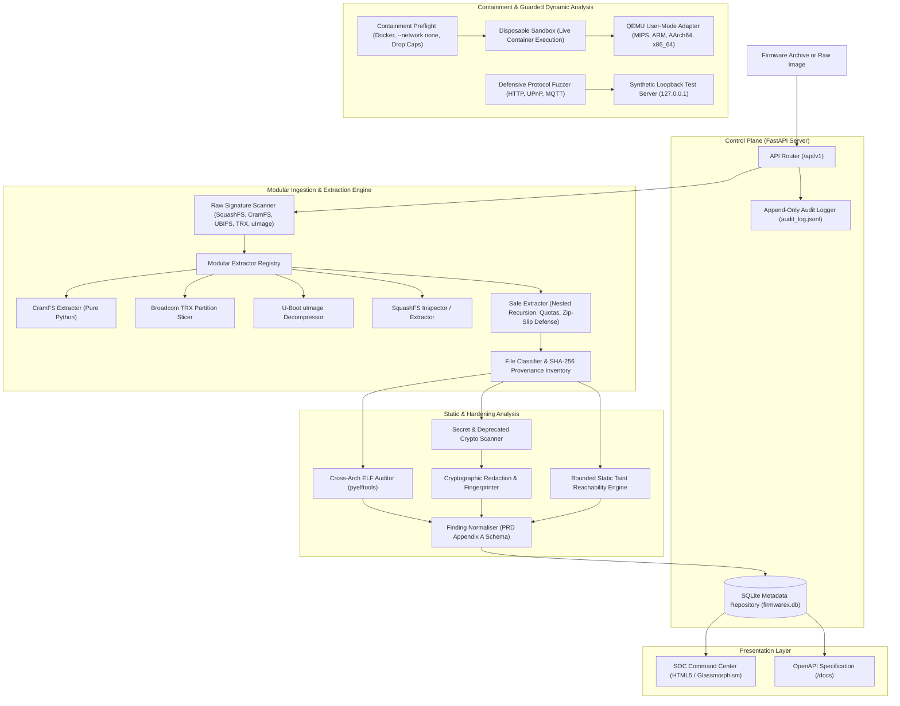

# FirmwareX — System Architecture & Containment Design

## 1. System Overview & Component Layout

FirmwareX implements a decoupled, defensive architecture designed to parse and audit untrusted IoT firmware without exposing the host operating system to arbitrary binary execution, memory corruption, or network egress risks.

---

## 2. Component Specifications

### 2.1 Modular Firmware Filesystem Extractors (`firmwarex/core/extractors/`)
* **Extractor Registry (`registry.py`):** Coordinates format discovery and dispatches to appropriate handlers. Supports offset-based scanning to unpack filesystems embedded behind bootloader padding.
* **CramFS Extractor (`cramfs_extractor.py`):** Pure-Python parser for Linux Compressed ROM filesystems (little-endian `0x28cd3d45` and big-endian `0x453dcd28`). Unpacks directory trees and decompresses zlib file data blocks while enforcing Zip Slip and quota boundaries.
* **Broadcom TRX Extractor (`trx_extractor.py`):** Pure-Python parser for Broadcom `HDR0` containers. Validates lengths and CRC32, extracts bootloader, kernel, and rootfs partitions, and recurses into contained filesystems.
* **U-Boot uImage Extractor (`uimage_extractor.py`):** Pure-Python parser for legacy U-Boot images (`0x27051956`). Validates header and data CRC checksums and automatically decompresses gzip and bzip2 payloads.
* **SquashFS Extractor (`squashfs_extractor.py`):** Parses SquashFS 4.0/3.0 superblocks (block sizes, inode counts, compression types). Executes `unsquashfs` under isolation when installed, or reports explicit `UNSUPPORTED` diagnostics when external binaries are missing.
* **JFFS2 & UBIFS Extractors (`jffs2_ubifs_extractor.py`):** Inspects JFFS2 node headers and UBI eraseblock delimiters, reporting structured diagnostic guidance for `jffs2dump` and `ubireader`.

### 2.2 Safe Archive Unpacking & Ingestion (`unpacker.py`, `raw_detector.py`)
* **Zip Slip Defense:** Every entry's canonical destination path is resolved and verified against the sandbox root (`target.resolve() == base or base in target.resolve().parents`).
* **Symlink Containment:** Symbolic and hard links are verified to resolve strictly inside the isolated extraction directory. Out-of-bounds symlinks throw a `SecurityException`.
* **Special Device Blocking:** Archives containing FIFOs, character devices, or block nodes are immediately terminated to prevent named pipe stalls or system device corruption.
* **Quota Management:** Enforces cumulative file counts (5,000 files default) and total uncompressed size ceilings (250 MB default) across all nested and extracted layers.

### 2.3 Cross-Architecture ELF Auditor (`elf_auditor.py`)
* **Multi-Architecture Support:** Handles MIPS (Big Endian), MIPSEL (Little Endian), ARM32, ARM64/AArch64, x86, and x86_64.
* **Mitigation Inspection:**
  * **NX/DEP:** Evaluates `PT_GNU_STACK` segment flags (`PF_X` check).
  * **RELRO:** Evaluates `PT_GNU_RELRO` and `DT_BIND_NOW` / `DF_BIND_NOW` (distinguishing Full vs. Partial RELRO).
  * **PIE/ASLR:** Distinguishes position-independent executables (`ET_DYN`) from fixed-base binaries (`ET_EXEC`).
  * **Stack Canaries:** Scans dynamic symbol tables for `__stack_chk_fail` or `__stack_chk_guard`.
  * **FORTIFY_SOURCE:** Detects wrapped libc functions (`__*_chk`).
* **Suspicious Sinks:** Discovers dynamic imports of banned functions (`strcpy`, `sprintf`, `system`, `popen`, `gets`). Classified explicitly as triage leads rather than confirmed vulnerabilities.

### 2.4 Secret Scanner & Cryptographic Redactor (`secret_scanner.py`, `redactor.py`)
* **Pattern Detection:** Regex rules for private keys (RSA/EC/OpenSSH), AWS tokens, hardcoded passwords, and shadow hashes.
* **Shannon Entropy Analysis:** Identifies high-entropy alphanumeric substrings ($H > 4.6$) indicating undocumented API tokens or symmetric keys.
* **Deprecated Cryptography:** Flags references to broken algorithms (MD5, SHA-1, DES, RC4).
* **Mandatory Redaction Engine:** Replaces raw values with masked previews (`AKIA**************PLE`) and computes immutable SHA-256 fingerprints. Raw secrets are never written to database tables, logs, or JSON outputs.

### 2.5 Bounded Static Taint Analysis Engine (`symbolic_analyzer.py`)
* **Source-to-Sink Dataflow Mapping:** Identifies candidate call paths linking untrusted input sources (`recv`, `read`, `getenv`, `argv`) to dangerous sinks (`system`, `popen`, `strcpy`, `sprintf`).
* **Truthful Designation:** All matches are strictly tagged as **`REVIEW_LEAD`** with `confidence: "candidate"`, `analysis_method: "static_symbol_reachability"`, and explicit limitation notices.
* **Bounded Budgeting:** Enforces strict exploration budgets (10,000 instructions, 10 paths, 5-second timeout, 256 MB memory).
* **Platform Fallback:** In the absence of `angr` on Python 3.14 Windows, provides a clean deterministic static reachability engine (`firmwarex_static_taint_v1`).

### 2.6 Executable Containment & QEMU Adapter (`sandbox_manager.py`, `qemu_adapter.py`)
* **Zero Host Execution:** Untrusted binaries are strictly blocked from execution on the Windows host.
* **Live Container Execution (`DisposableSandbox`):** Executes commands in disposable Docker containers enforcing:
  - `--network none` (strict network egress denial).
  - `--read-only` root filesystem.
  - `--cap-drop=ALL` (drops all Linux capabilities).
  - `--security-opt=no-new-privileges:true`.
  - Non-root user (`1000:1000`).
* **Live Telemetry (`ContainmentPreflight.verify_live_containment`):** Runs automated live probes to prove network denial, non-root execution, and read-only filesystem integrity.
* **QEMU User-Mode Adapter:** Maps architectures (MIPS, ARM, AArch64, x86_64) to QEMU emulators. Returns distinct honest states (`tool_unavailable`, `isolation_blocked`, `unsupported_architecture`, `timeout`, `crashed`, `completed`).

### 2.7 Defensive Protocol Fuzzing Foundation (`firmwarex/fuzzing/`)
* **Strict Loopback Isolation:** Target hosts must resolve strictly to `127.0.0.1` or `localhost`. Non-local targets are rejected fail-closed.
* **Multi-Protocol Support:** Modular support for HTTP, UPnP (SSDP M-SEARCH), and MQTT (3.1.1 CONNECT and PUBLISH packets).
* **Deterministic Mutations:** Seeded pseudo-random mutations covering oversized headers, format string specifiers (`%s%n`), integer boundary numbers, path traversals, null-bytes, and malformed delimiters.
* **Synthetic Test Server (`SyntheticLocalTestServer`):** In-process loopback server for testing fuzzer detection of 500 errors, connection drops, and anomaly classification end-to-end.

---

## 3. Storage & Audit Architecture

* **Database:** SQLite (`firmwarex.db`) tracking firmwares, analysis jobs, file inventory (with provenance and nesting level), binary audits, detected signatures, and normalized findings.
* **Immutable Audit Log:** `audit_log.jsonl` provides an append-only audit trail recording timestamps, event types, firmware digests, and security exceptions.
