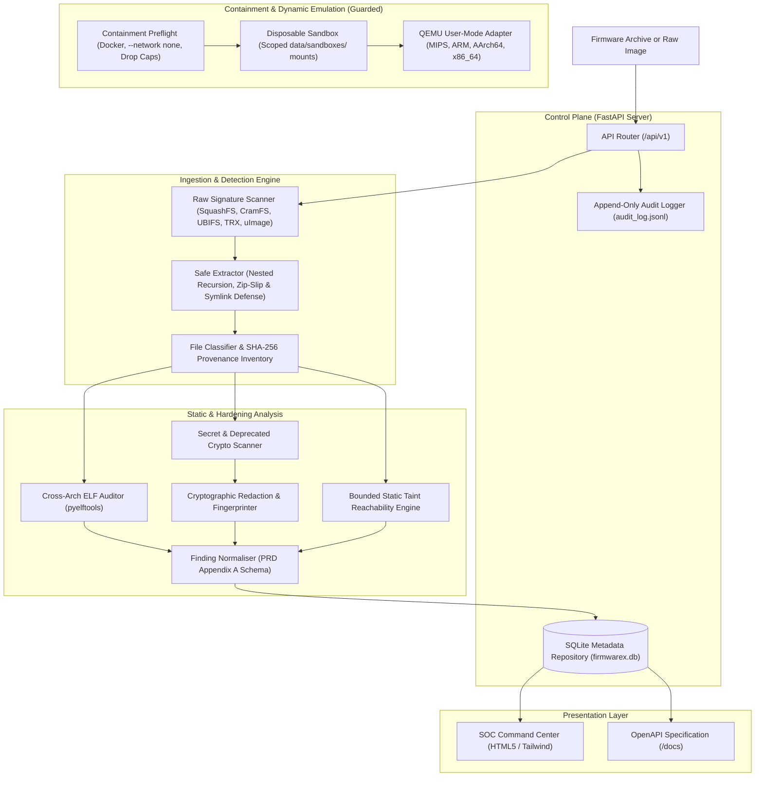

# FirmwareX — System Architecture & Containment Design

## 1. System Overview & Component Layout

FirmwareX implements a decoupled, defensive architecture designed to parse and audit untrusted IoT firmware without exposing the host operating system to arbitrary binary execution, memory corruption, or network egress risks.

---

## 2. Component Specifications

### 2.1 Raw Signature Detection & Safe Unpacking (`raw_detector.py`, `unpacker.py`)
* **Raw Signature Scanner:** Scans input streams for magic bytes at offset 0 and embedded offsets (SquashFS, CramFS, JFFS2, UBIFS, TRX, uImage, Netgear CHK, D-Link SHRS, DTB, Android Boot).
* **Honest Detection Boundary:** Signature detection is strictly decoupled from extraction. Raw container images return HTTP 422 with detected offsets and recommended extraction tools (`unsquashfs`, `cramfsck`, `jffs2dump`, `ubireader`).
* **Nested Archive Recursion:** Recursively unpacks nested archives up to `MAX_NESTING_DEPTH = 3` while tracking file provenance (`parent_archive`, `nesting_level`).
* **Zip Slip Defense:** Every entry's canonical destination path is resolved and verified against the sandbox root (`target.resolve() == base or base in target.resolve().parents`).
* **Symlink Containment:** Symbolic and hard links are verified to resolve strictly inside the isolated extraction directory. Out-of-bounds symlinks throw a `SecurityException`.
* **Special Device Blocking:** Archives containing FIFOs, character devices, or block nodes are immediately terminated to prevent named pipe stalls or system device corruption.
* **Quota Management:** Enforces cumulative file counts (10,000 files) and total uncompressed size ceilings (1 GB) across all nested layers.

### 2.2 Cross-Architecture ELF Auditor (`elf_auditor.py`)
* **Multi-Architecture Support:** Handles MIPS (Big Endian), MIPSEL (Little Endian), ARM32, ARM64/AArch64, x86, and x86_64.
* **Mitigation Inspection:**
  * **NX/DEP:** Evaluates `PT_GNU_STACK` segment flags (`PF_X` check).
  * **RELRO:** Evaluates `PT_GNU_RELRO` and `DT_BIND_NOW` / `DF_BIND_NOW` (distinguishing Full vs. Partial RELRO).
  * **PIE/ASLR:** Distinguishes position-independent executables (`ET_DYN`) from fixed-base binaries (`ET_EXEC`).
  * **Stack Canaries:** Scans dynamic symbol tables for `__stack_chk_fail` or `__stack_chk_guard`.
  * **FORTIFY_SOURCE:** Detects wrapped libc functions (`__*_chk`).
* **Suspicious Sinks as Review Leads:** Discovers dynamic imports of banned functions (`strcpy`, `sprintf`, `system`, `popen`, `gets`). Classified explicitly as triage leads rather than confirmed vulnerabilities.

### 2.3 Secret Scanner & Cryptographic Redactor (`secret_scanner.py`, `redactor.py`)
* **Pattern Detection:** Regex rules for private keys (RSA/EC/OpenSSH), AWS tokens, hardcoded passwords, and shadow hashes.
* **Shannon Entropy Analysis:** Identifies high-entropy alphanumeric substrings ($H > 4.6$) indicating undocumented API tokens or symmetric keys.
* **Deprecated Cryptography:** Flags references to broken algorithms (MD5, SHA-1, DES, RC4).
* **Mandatory Redaction Engine:** Replaces raw values with masked previews (`AKIA**************PLE`) and computes immutable SHA-256 fingerprints. Raw secrets are never written to database tables, logs, or JSON outputs.

### 2.4 Bounded Symbolic & Taint Analysis Engine (`symbolic_analyzer.py`)
* **Source-to-Sink Dataflow Mapping:** Identifies candidate call paths linking untrusted input sources (`recv`, `read`, `getenv`, `argv`) to dangerous sinks (`system`, `popen`, `strcpy`, `sprintf`).
* **Truthful Designation:** All matches are strictly tagged as **`REVIEW_LEAD`**, never as verified exploits.
* **Bounded Budgeting:** Enforces strict exploration budgets (10,000 instructions, 10 paths, 5-second timeout, 256 MB memory).
* **Engine Fallback:** In the absence of `angr` on Python 3.14 Windows, provides a clean deterministic static reachability engine (`firmwarex_static_taint_v1`).

### 2.5 Containment & Guarded Dynamic Emulation (`sandbox_manager.py`, `qemu_adapter.py`)
* **Zero Host Execution:** Untrusted binaries are strictly blocked from execution on the Windows host.
* **Preflight Verification (`ContainmentPreflight`):** Verifies Docker daemon status, `--network none` network isolation, `--read-only` rootfs, and dropped capabilities (`--cap-drop=ALL`).
* **Scoped Sandbox Mounts:** Permits mounting only disposable subdirectories inside `data/sandboxes/`. Rejects host roots, home directories, and `docker.sock`.
* **QEMU User-Mode Adapter:** Maps architectures (MIPS, ARM, AArch64, x86_64) to QEMU emulators with a verified mock execution test harness. Full-system emulation remains safely deferred.

### 2.6 Finding Normaliser (`normaliser.py`)
* Conforms strictly to **PRD Appendix A (JSON Finding Schema)** and maps findings to **Appendix B CWEs** (CWE-120, CWE-78, CWE-798, CWE-321, CWE-327, CWE-328).
* Populates diagnostic `crash_state` with `null` fields during static analysis, avoiding artificial or fabricated dynamic execution data.

---

## 3. Storage & Audit Architecture

* **Database:** SQLite (`firmwarex.db`) tracking firmwares, analysis jobs, file inventory (with provenance and nesting level), binary audits, detected signatures, and normalized findings.
* **Immutable Audit Log:** `audit_log.jsonl` provides an append-only audit trail recording timestamps, event types, firmware digests, and security exceptions.
