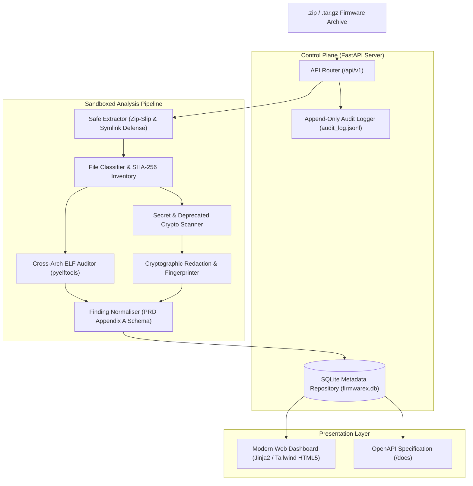

# FirmwareX — System Architecture & Containment Design

## 1. System Overview & Component Layout

FirmwareX implements a decoupled, defensive architecture designed to parse and audit untrusted IoT firmware without exposing the host operating system to arbitrary binary execution or memory corruption risks.

---

## 2. Component Specifications

### 2.1 Safe Extractor (`firmwarex/core/unpacker.py`)
* **Zip Slip Defense:** Every entry's canonical destination path is resolved and verified against the sandbox root (`target.resolve() == base or base in target.resolve().parents`).
* **Symlink Containment:** Symbolic and hard links are verified to resolve strictly inside the isolated extraction directory. Out-of-bounds symlinks throw a `SecurityException`.
* **Special Device Blocking:** Archives containing FIFOs, character devices, or block nodes are immediately terminated to prevent named pipe stalls or system device corruption.
* **Quota Management:** Enforces a maximum file count (10,000 files) and total uncompressed size ceiling (1 GB) to neutralise archive decompression bombs.

### 2.2 Cross-Architecture ELF Auditor (`firmwarex/core/elf_auditor.py`)
* **Multi-Architecture Support:** Handles MIPS (Big Endian), MIPSEL (Little Endian), ARM32, ARM64/AArch64, x86, and x86_64.
* **Mitigation Inspection:**
  * **NX/DEP:** Evaluates `PT_GNU_STACK` segment flags. The presence of `PF_X` indicates an executable stack (`not_detected`), while its absence indicates non-executable stack protection (`enabled`).
  * **RELRO:** Evaluates `PT_GNU_RELRO` and `DT_BIND_NOW` / `DF_BIND_NOW`. Distinguishes between Full RELRO (read-only GOT) and Partial RELRO.
  * **PIE/ASLR:** Distinguishes position-independent executables (`ET_DYN`) from fixed-base binaries (`ET_EXEC`).
  * **Stack Canaries:** Scans dynamic symbol tables for `__stack_chk_fail` or `__stack_chk_guard`.
  * **FORTIFY_SOURCE:** Detects wrapped libc functions (`__*_chk`).
* **Suspicious Sinks as Review Leads:** Discovers dynamic imports of banned functions (`strcpy`, `sprintf`, `system`, `popen`, `gets`). Classified explicitly as triage leads rather than confirmed vulnerabilities.

### 2.3 Secret Scanner & Cryptographic Redactor (`firmwarex/core/secret_scanner.py`, `redactor.py`)
* **Pattern Detection:** Regex rules for private keys (RSA/EC/OpenSSH), AWS tokens, hardcoded passwords, and shadow hashes.
* **Shannon Entropy Analysis:** Identifies high-entropy alphanumeric substrings ($H > 4.6$) indicating undocumented API tokens or symmetric keys.
* **Deprecated Cryptography:** Flags references to broken algorithms (MD5, SHA-1, DES, RC4).
* **Mandatory Redaction Engine:** Replaces raw values with masked previews (`AKIA**************PLE`) and computes immutable SHA-256 fingerprints. Raw secrets are never written to database tables, logs, or JSON outputs.

### 2.4 Finding Normaliser (`firmwarex/core/normaliser.py`)
* Conforms strictly to **PRD Appendix A (JSON Finding Schema)** and maps findings to **Appendix B CWEs** (CWE-120, CWE-78, CWE-798, CWE-321, CWE-327, CWE-328).
* Populates diagnostic `crash_state` with `null` fields during static analysis, avoiding artificial or fabricated dynamic execution data.

---

## 3. Storage & Audit Architecture

* **Database:** SQLite (`firmwarex.db`) tracking firmwares, analysis jobs, file inventory, binary audits, and normalized findings.
* **Immutable Audit Log:** `audit_log.jsonl` provides an append-only audit trail recording timestamps, event types, firmware digests, and security exceptions.

