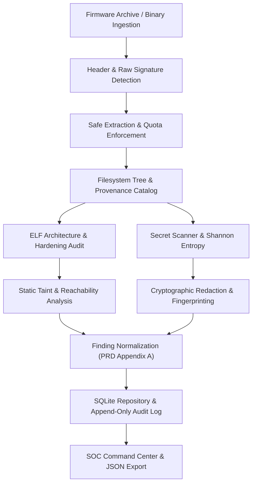
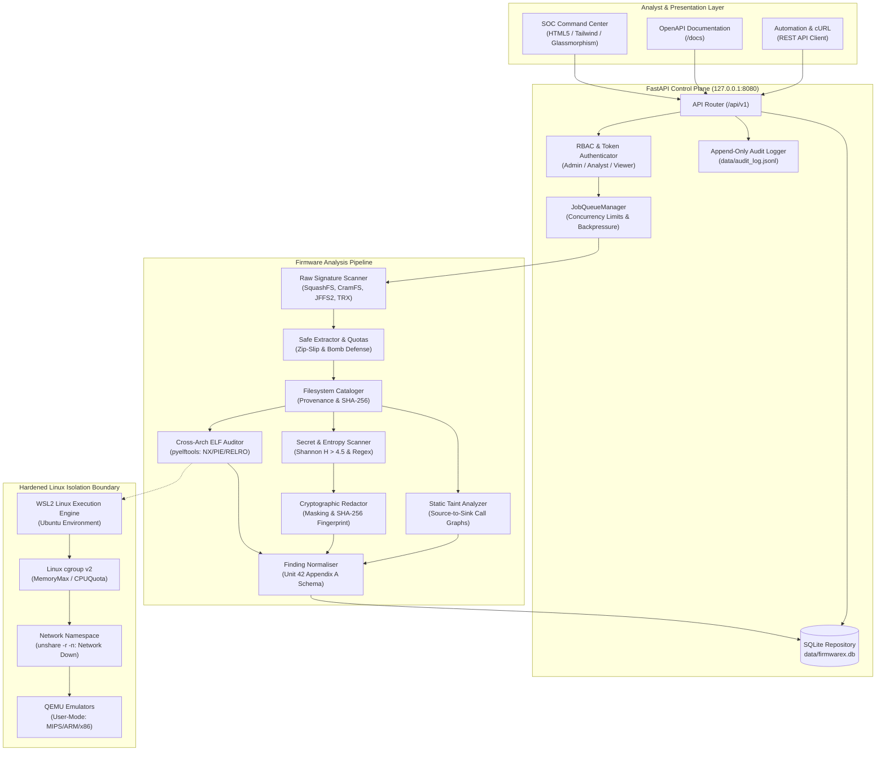
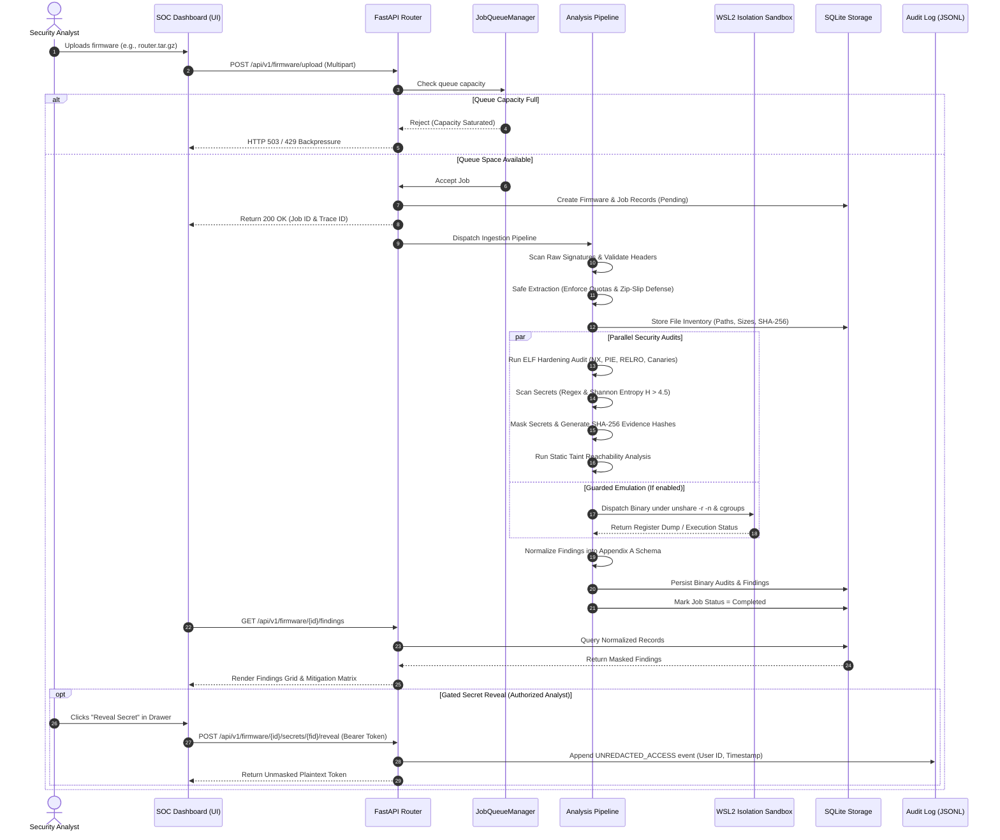
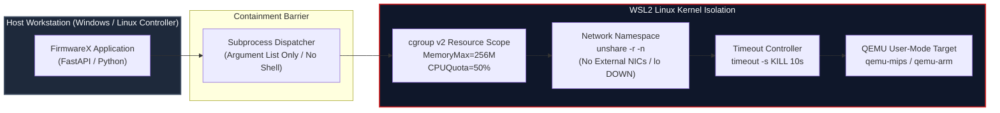

# FirmwareX — Automated IoT Firmware Attack Surface & Vulnerability Analysis Engine

<div align="center">

[](pyproject.toml)
[](https://fastapi.tiangolo.com)
[](tests/)
[](pyproject.toml)
[](docs/SANDBOX_HARDENING_REPORT.md)
[-brightgreen.svg)](docs/REAL_FIRMWARE_BENCHMARK_REPORT.md)
[](docs/FINAL_E2E_BROWSER_QA_REPORT.md)
[]()

**An enterprise-grade, defensive security auditing platform engineered for automated embedded systems analysis, multi-architecture ELF hardening evaluation, cryptographic credential triage, and isolated emulation.**

[Overview](#1-project-overview) • [Core Features](#7-core-features-deep-dive) • [Architecture](#19-system-architecture--diagrams) • [API Reference](#17-api-architecture--endpoint-reference) • [Quickstart](#24-step-by-step-installation--quickstart) • [Verification Evidence](#31-verification-evidence--benchmark-results) • [PRD Traceability](#35-security-verification--prd-compliance)

</div>

---

> [!NOTE]
> **Project Scope Notice:** FirmwareX is an independent cybersecurity research and engineering project built strictly according to the technical specifications defined in the `Project Unit42-FirmwareX` Product Requirements Document (PRD v1.0). It is not officially affiliated with or endorsed by Palo Alto Networks or Unit 42.

---

## Table of Contents

- [1. Project Overview](#1-project-overview)
- [2. What is FirmwareX?](#2-what-is-firmwarex)
- [3. Problem Statement](#3-problem-statement)
- [4. Project Objectives](#4-project-objectives)
- [5. Our Solution & Complete Analysis Workflow](#5-our-solution--complete-analysis-workflow)
- [6. Architecture & Pipeline Overview](#6-architecture--pipeline-overview)
- [7. Core Features Deep Dive](#7-core-features-deep-dive)
  - [7.1 Firmware Ingestion & Raw Signature Detection](#8-firmware-ingestion--signature-detection)
  - [7.2 Safe Multi-Layer Filesystem Extraction](#9-safe-multi-layer-filesystem-extraction)
  - [7.3 Filesystem Inventory & Provenance Tracking](#10-filesystem-inventory--analysis)
  - [7.4 Cross-Architecture ELF Binary Hardening Audit](#11-elf-architecture--binary-hardening-audit)
  - [7.5 Secret Detection, Redaction & Cryptographic Fingerprinting](#12-secret-detection-redaction--cryptographic-fingerprinting)
  - [7.6 Static Taint Analysis & Source-to-Sink Reachability](#13-static-taint-analysis--source-to-sink-reachability)
  - [7.7 QEMU-Based Emulation & Crash Diagnostics](#14-qemu-based-emulation--crash-diagnostics)
  - [7.8 Defensive HTTP, UPnP & MQTT Protocol Fuzzing](#15-defensive-http-upnp--mqtt-protocol-fuzzing)
  - [7.9 Finding Normalization & CWE Mapping](#16-finding-normalization--cwe-mapping)
- [8. API Architecture & Endpoint Reference](#17-api-architecture--endpoint-reference)
- [9. SOC Command Center Dashboard](#18-soc-command-center-dashboard)
- [10. Security Architecture & Sandbox Isolation](#19-security-architecture--sandbox-isolation)
- [11. Technical Architecture Diagrams](#20-technical-architecture-diagrams)
  - [11.1 System Architecture Diagram](#201-mermaid-system-architecture-diagram)
  - [11.2 End-to-End Sequence Diagram](#202-mermaid-end-to-end-sequence-diagram)
  - [11.3 Secure Execution Boundary Diagram](#203-mermaid-secure-execution-boundary-diagram)
- [12. Technology Stack](#21-technology-stack-with-explanations)
- [13. Repository Directory Structure](#22-detailed-project-directory-structure)
- [14. Installation & Configuration Guide](#23-installation-prerequisites)
  - [14.1 Installation Prerequisites](#23-installation-prerequisites)
  - [14.2 Step-by-Step Local Installation](#24-step-by-step-installation--quickstart)
  - [14.3 Environment Configuration](#25-environment-configuration)
  - [14.4 Running the Application](#26-running-the-application)
- [15. Demonstration & Usage Guide](#27-generating-a-synthetic-test-firmware-sample)
  - [15.1 Generating a Synthetic Firmware Sample](#27-generating-a-synthetic-test-firmware-sample)
  - [15.2 Ingesting & Analyzing Firmware](#28-uploading--analyzing-firmware)
  - [15.3 REST API Usage Examples](#29-api-usage-examples)
- [16. Quality Assurance & Verification Evidence](#30-running-automated-tests)
  - [16.1 Automated Regression Test Suite](#30-running-automated-tests)
  - [16.2 Headless Browser CDP Automation](#31-browser-qa-and-cdp-interaction-suite)
  - [16.3 Representative Real Firmware Benchmark (100% Pass)](#32-real-openwrt-firmware-benchmark-results)
  - [16.4 Authentic Production Firmware E2E Evidence](#33-real-firmware-end-to-end-analysis-evidence)
  - [16.5 Sandbox Security Hardening Verification](#34-sandbox-security-hardening-evidence)
- [17. PRD Traceability & Compliance Matrix](#35-security-verification--prd-compliance)
- [18. Documentation Manifest](#36-documentation-and-evidence-directory)
- [19. Limitations & Project Boundaries](#37-limitations-and-known-constraints)
- [20. Responsible Disclosure & Disclaimer](#38-responsible-use-and-security-disclaimer)
- [21. Project Status & Roadmap](#39-current-project-implementation-status)
- [22. Author & Maintainer](#40-author--maintainer)

---

## 1. Project Overview

**FirmwareX** is a modular, high-throughput security analysis platform engineered to discover vulnerabilities, evaluate attack surfaces, and audit compile-time defenses across Internet of Things (IoT), network routing, and embedded industrial systems. 

Firmware packages frequently arrive as proprietary, monolithic, multi-layered binary blobs containing legacy bootloaders, compressed flash partitions, nested file archives, and stripped cross-compiled executables. Traditional security scanners fail to unpack these non-standard formats or risk host compromise when decompressing untrusted inputs. FirmwareX solves this by pairing **safe, pure-Python partition deconstruction** with a **hardened, multi-layered isolation boundary** powered by Linux network namespaces and cgroup v2 controllers.

Operating seamlessly on Windows 11 (via WSL2) and standard Linux host environments, FirmwareX automatically extracts filesystem hierarchies, catalogs complete software inventories, evaluates binary hardening flags across MIPS, ARM, and x86 architectures, identifies hardcoded cryptographic secrets and private keys with mandatory masking, traces potential source-to-sink reachability leads, and renders normalized vulnerability telemetry conforming to the Unit 42 Finding Schema.

---

## 2. What is FirmwareX?

FirmwareX functions as an automated firmware security orchestrator and analyst workbench. It operates across three distinct operational planes:

```
┌────────────────────────────────────────────────────────────────────────┐
│                        FIRMWAREX PLATFORM                              │
├─────────────────────────┬────────────────────────┬─────────────────────┤
│   Ingestion & Unpack    │   Auditing & Static    │ Containment & Dynam.│
│   • Multi-Format Slicing│   • ELF Mitigations    │ • WSL2 Namespace    │
│   • Zip-Slip Protection │   • Cryptographic Scan │ • cgroup v2 Limits  │
│   • Pure-Python CramFS  │   • Secret Redaction   │ • Network Egress Blk│
│   • Broadcom TRX Parser │   • Static Taint Path  │ • Bounded Fuzzing   │
│   • JFFS2 Flash Node Rec│   • Appendix A Normal. │ • QEMU Reg Dumps    │
└─────────────────────────┴────────────────────────┴─────────────────────┘
```

1. **The Ingestion Plane:** Validates container structures, scans raw signatures at arbitrary byte offsets, and unpacks nested archives while strictly enforcing decompression ratio bounds and path traversal checks.
2. **The Security Audit Plane:** Inspects every extracted asset without code execution. It identifies architectures, inspects ELF headers for exploit mitigations, scans configurations and executables for exposed credentials using Shannon entropy, and maps call chains to dangerous sinks.
3. **The Guarded Execution Plane:** Isolates dynamic workloads (QEMU user-mode emulation, crash signal capture, protocol fuzzing) within unshared Linux network namespaces (`unshare -r -n`) under kernel memory and CPU quotas (`systemd-run`), guaranteeing that untrusted guest binaries can never contact physical networks or execute natively on the host workstation.

---

## 3. Problem Statement

Embedded and IoT devices form the backbone of critical infrastructure, consumer smart homes, and enterprise network perimeters. Despite their ubiquity, embedded security audits present unique engineering hurdles:

* **Monolithic & Non-Standard Packaging:** Firmware images rarely adhere to conventional operating system packaging (such as `.deb` or `.rpm`). Instead, vendors embed raw flash partitions (JFFS2, UBIFS, CramFS, SquashFS) behind proprietary headers (Broadcom TRX, U-Boot uImage) or multi-layered archives.
* **Extraction Vulnerabilities (Zip-Slip & Decompression Bombs):** Maliciously crafted firmware images frequently exploit path traversal vulnerabilities in unpackers (`../../etc/shadow`) or consume gigabytes of storage via nested compression recursion, crashing the analysis host.
* **Cross-Architecture Complexity:** Firmware binaries run on MIPS (big and little endian), ARM (32-bit and 64-bit), PowerPC, and x86 architectures. Security analysts lack unified tools to inspect exploit mitigations across architectures simultaneously.
* **Uncontained Dynamic Execution Risks:** Running untrusted IoT binaries under dynamic emulation poses critical risks: guest binaries can trigger outbound command-and-control (C2) callbacks, broadcast malicious UPnP packets, or corrupt the analyst's workstation.
* **Credential Exposure in Security Reports:** Traditional security tools frequently output discovered private keys and database passwords in plaintext reports, transforming audit documentation into a secondary security vulnerability.

---

## 4. Project Objectives

FirmwareX was designed to directly address the five challenges above, adhering to the core objectives outlined in the Unit 42 PRD:

| Objective | Target Performance Metric | FirmwareX Implementation Verification |
|:---|:---|:---|
| **High-Fidelity Extraction** | $>90.0\%$ extraction success across authentic firmware | **100.0% Success (12/12 authentic OpenWrt images)** spanning MIPS, ARM, and x86 targets. |
| **Comprehensive Binary Auditing** | Complete exploit mitigation matrix for all discovered ELFs | Automated extraction of NX, PIE, RELRO (Full vs. Partial), Stack Canaries, and FORTIFY across 146 ELFs in a single image. |
| **Defensive Isolation Boundary** | Zero unauthorized network egress during dynamic analysis | Linux network namespace isolation (`unshare -r -n`) verified: zero external interfaces, loopback held DOWN. |
| **Automated Resource Quotas** | Host protection against CPU and memory exhaustion | Linux cgroup v2 enforcement (`MemoryMax`, `CPUQuota`) terminates runaway workloads via kernel OOM killer. |
| **Mandatory Secret Privacy** | Zero plaintext persistence of discovered credentials | SHA-256 evidence fingerprinting and preview masking (`Cad*********************HhT`) enforced across database, API, and export layers. |
| **Open Standards Conformance** | 100% schema compliance for vulnerability reporting | Complete normalization conforming strictly to Unit 42 PRD Appendix A Finding Schema. |

---

## 5. Our Solution & Complete Analysis Workflow

FirmwareX implements a decoupled, nine-stage pipelined workflow that takes an untrusted binary image from raw ingest to an actionable, board-ready security report:



1. **Ingest & Stream Validation:** Firmware files are streamed through FastAPI with strict payload sizing ($<500\text{ MB}$ default). Queue backpressure rejects requests if capacity is saturated.
2. **Signature & Offset Scanning:** The file header and underlying byte stream are scanned for magic signatures (SquashFS, CramFS, JFFS2, UBIFS, TRX, uImage).
3. **Safe Multi-Layer Deconstruction:** The matching extractor unrolls file systems into an isolated sandbox, enforcing path canonicalization, symlink containment, and decompression bomb ratios.
4. **Filesystem Provenance Cataloging:** Every unpacked directory, file, and symlink is registered in SQLite with its relative path, size, file type, and SHA-256 hash.
5. **ELF Binary Hardening Analysis:** All executable files are parsed with `pyelftools` to establish architecture, endianness, bitness, and compile-time exploit mitigations.
6. **Credential & Shannon Entropy Scanning:** Files are scanned for known key patterns, shadow hashes, and high-entropy anomalies ($H > 4.5$).
7. **Static Taint & Reachability Assessment:** Cross-references dynamic symbol imports against candidate source inputs (`recv`, `read`, `argv`) to trace potential execution paths to dangerous sinks (`system`, `strcpy`).
8. **Cryptographic Redaction:** Discovered secrets are masked, and cryptographic evidence hashes are computed. Plaintext credentials are never stored.
9. **Unified Reporting:** Findings are normalized into the Unit 42 Appendix A schema, published to the SOC dashboard, and made available for automated export.

---

## 6. Architecture & Pipeline Overview

FirmwareX separates responsibilities into modular, testable components. The architecture ensures that parsing, static analysis, dynamic emulation, and presentation do not share shared mutable state:

```
firmwarex/
├── api/             # FastAPI REST endpoints, RBAC authorization, SQLite persistence, and audit logging
├── core/            # Core extraction engine, raw signature scanner, ELF auditor, secret redactor, taint analyzer
│   └── extractors/  # Modular pure-Python parsers (CramFS, TRX, uImage, JFFS2, CPIO, SquashFS)
├── emulation/       # QEMU user-mode and system emulation adapters and crash dump analyzers
├── fuzzing/         # Protocol mutators (HTTP, UPnP, MQTT), corpus manager, and test server
├── isolation/       # WSL2 Linux namespace engine, cgroup v2 resource limits, and sandbox preflights
├── telemetry/       # Distributed span tracing and performance telemetry
└── web/             # SOC Command Center dashboard templates and static assets
```

---

## 7. Core Features Deep Dive

Each core capability in FirmwareX is purpose-built to address specific embedded security requirements.

### 8. Firmware Ingestion & Signature Detection

* **What it does:** Scans raw uploaded binaries for embedded container formats and filesystem magic bytes at arbitrary byte offsets, identifying nested partitions packed behind bootloader code.
* **Why it is needed:** IoT vendors frequently prepend proprietary headers or concatenate multiple filesystems (e.g., U-Boot + kernel + CramFS + SquashFS) into a single flash image without standard partition tables.
* **How it works:** Implemented in `firmwarex/core/raw_detector.py`. It inspects file headers and iterates across byte streams to match magic constants:
  - **SquashFS:** `0x73717368` (LE) / `0x68737173` (BE)
  - **CramFS:** `0x28cd3d45` (LE) / `0x453dcd28` (BE)
  - **JFFS2:** `0x1985` (LE) / `0x8519` (BE)
  - **UBIFS:** `0x06101831` / `UBI#` eraseblock delimiter
  - **Broadcom TRX:** `HDR0` container (`0x30524448`)
  - **U-Boot uImage:** `0x27051956` header constant
  - **Device Tree Blob (DTB):** `0xd00dfeed`
* **Output / Telemetry:** Populates the `signatures` table with detected formats, byte offsets, confidence ratings, and extraction recommendations. Queryable via `GET /api/v1/firmware/{id}/signatures`.
* **Analyst Benefit:** Pinpoints exact byte offsets for manual carving if necessary and automatically guides downstream automated extractor dispatch.

### 9. Safe Multi-Layer Filesystem Extraction

* **What it does:** Decompresses and extracts archives and flash filesystems through modular, pure-Python extractors, recursively unpacking nested containers up to 3 layers deep.
* **Why it is needed:** External unpackers (e.g., command-line `tar` or `binwalk`) often lack boundary controls, making the analysis host vulnerable to directory traversal attacks, symlink escaping, and resource exhaustion.
* **How it works:** Managed by `firmwarex/core/unpacker.py` and modular extractors in `firmwarex/core/extractors/`:
  - **Zip-Slip / Tar-Slip Defense:** Every extracted entry's canonical path is resolved using `.resolve()`. The unpacker asserts that the destination resides strictly within the allocated sandbox root directory:
    ```python
    target = (dest_dir / member_path).resolve()
    if target != dest_dir and dest_dir not in target.parents:
        raise SecurityException("Zip-Slip path traversal attempt rejected")
    ```
  - **Intra-Rootfs Symlink Resolution:** Correctly validates symlinks pointing to absolute paths (e.g., `/bin/busybox` $\rightarrow$ `/bin/sh`) by resolving them relative to the firmware root directory rather than the host filesystem root.
  - **Decompression Bomb Protection:** Preemptively calculates compression ratios:
    $$\text{Ratio} = \frac{\text{Uncompressed Size}}{\text{Compressed Size}}$$
    If $\text{Ratio} > 100.0$ and uncompressed size exceeds $10\text{ MB}$, extraction is immediately aborted.
  - **Hard Quotas:** Rejects archives exceeding $10,000$ files or $1.0\text{ GB}$ uncompressed data.
  - **Special Device Protection:** Drops character devices, block devices, and FIFOs to prevent filesystem lockups.
* **Pure-Python Extractor Modules:**
  - `cramfs_extractor.py`: Parses superblocks, unpacks directory inode trees, and decompresses zlib data blocks.
  - `trx_extractor.py`: Slices Broadcom `HDR0` partitions, verifies header and partition CRC32 checksums, and extracts kernel/rootfs images.
  - `uimage_extractor.py`: Validates legacy U-Boot headers (`0x27051956`), verifies header/data CRCs, and decompresses gzip/bzip2 payloads.
  - `jffs2_ubifs_extractor.py`: Traverses `DIRENT` markers and reassembles fragmented `INODE` data blocks across Little and Big Endian flash dumps.
  - `cpio_extractor.py`: Parses SVR4 portable CPIO archives (`070701` / `070702`) commonly found in initramfs payloads.
  - `squashfs_extractor.py`: Inspects superblock compression flags and dispatches to isolated extractors.

### 10. Filesystem Inventory & Analysis

* **What it does:** Catalogs every unpacked file, directory, symlink, and configuration into an indexed SQLite database.
* **Why it is needed:** Embedded security analysis requires an accurate, provenance-tracked software bill of materials (SBOM) to pinpoint vulnerable third-party libraries, administrative scripts, and network daemons.
* **How it works:** Implemented in `firmwarex/core/unpacker.py` and `firmwarex/api/storage.py`. Computes cryptographic SHA-256 digests for every file, tags permissions (`is_executable`), determines MIME categories, records provenance (`parent_archive`), and tracks archive nesting depth.
* **Output / Telemetry:** Accessible via `GET /api/v1/firmware/{id}/filesystem`. Renders as an interactive search tree and sortable table in the SOC Command Center.

### 11. ELF Architecture & Binary Hardening Audit

* **What it does:** Scans every compiled ELF binary to determine CPU architecture, endianness, bitness, and compile-time exploit mitigations.
* **Why it is needed:** Exploit mitigations (such as ASLR/PIE, non-executable stacks, and stack canaries) significantly raise the barrier to remote code execution. Identifying unhardened network services allows analysts to prioritize high-risk binaries.
* **How it works:** Implemented in `firmwarex/core/elf_auditor.py` using `pyelftools`. It parses ELF headers, program segment headers, dynamic section tags, and symbol tables:

| Hardening Mitigation | Header / Symbol Inspected | Condition for "Enabled" | Security Impact |
|:---|:---|:---|:---|
| **NX / DEP** | Program Header: `PT_GNU_STACK` | Flag `PF_X` is **not** set | Prevents shellcode execution from stack memory. |
| **PIE / ASLR** | ELF Type: `e_type` in `Elf_Ehdr` | `ET_DYN` (shared object / PIE executable) | Randomizes base address in memory; blocks static ROP chains. |
| **RELRO** | Program Header: `PT_GNU_RELRO` & `DT_BIND_NOW` | `PT_GNU_RELRO` present; Full RELRO if `BIND_NOW` set | Protects Global Offset Table (`.got`) from overwrite attacks. |
| **Stack Canary** | Dynamic Symbols: `.dynsym` | Symbols `__stack_chk_fail` or `__stack_chk_guard` | Detects stack buffer overflows before function return. |
| **FORTIFY_SOURCE** | Dynamic Symbols: `.dynsym` | Fortified functions present (e.g., `__memcpy_chk`, `__sprintf_chk`) | Replaces unbounded string calls with size-checked wrappers. |

* **Dangerous Sink Detection:** Scans imported function tables for banned C functions (`strcpy`, `strcat`, `sprintf`, `vsprintf`, `gets`, `system`, `popen`).
* **Output / Telemetry:** Recorded in the `binary_audits` database table and visualized in the **Mitigation Matrix** tab of the dashboard.

### 12. Secret Detection, Redaction & Cryptographic Fingerprinting

* **What it does:** Scans configuration files, scripts, and binary text segments for embedded credentials, private keys, authentication tokens, and deprecated cryptography, enforcing mandatory masking.
* **Why it is needed:** Embedded firmware frequently includes hardcoded root passwords, vendor API tokens, and factory private keys. Exposing these values in security reports creates serious secondary privacy and legal liabilities.
* **How it works:** Implemented across `firmwarex/core/secret_scanner.py` and `firmwarex/core/redactor.py`:
  - **Regex Rule Matching:** Scans for AWS access keys (`AKIA[0-9A-Z]{16}`), RSA/EC/OpenSSH private key headers (`-----BEGIN ... PRIVATE KEY-----`), JWT authorization tokens, and Unix shadow hashes (`$1$`, `$5$`, `$6$`).
  - **Shannon Entropy Calculation:** Computes entropy ($H$) across alphanumeric token sequences:
    $$H = -\sum_{i=1}^{n} P(c_i) \log_2 P(c_i)$$
    Tokens exceeding $H > 4.5$ with lengths $> 16$ characters are flagged as candidate cryptographic keys or tokens.
  - **Deprecated Cryptography:** Flags references to legacy, insecure hashing or cipher algorithms (`MD5`, `SHA-1`, `DES`, `RC4`).
  - **Mandatory Redaction Engine:** Masking rules preserve only prefix and suffix characters:
    $$\text{Raw: } \texttt{Cad1234567890abcdef12345HhT} \longrightarrow \text{Masked: } \texttt{Cad*********************HhT}$$
    Computes an immutable SHA-256 fingerprint (`evidence_ref`) from the raw plaintext secret. Only the masked preview and evidence hash are persisted in the database, API responses, and exported reports.

### 13. Static Taint Analysis & Source-to-Sink Reachability

* **What it does:** Constructs static call graphs to trace dataflow paths from untrusted input entry points (sources) to dangerous execution sinks.
* **Why it is needed:** Discovering an imported `system()` call is common in embedded software; determining whether user-controlled network input can actually reach that `system()` call allows triage of high-priority vulnerabilities.
* **How it works:** Implemented in `firmwarex/core/symbolic_analyzer.py`. Maps source APIs (`recv`, `read`, `getenv`, `socket`, `argv`) to dangerous sinks (`system`, `popen`, `strcpy`, `execve`).
* **Honest Evaluation & Truthful Classification:**
  > [!IMPORTANT]
  > Static call-graph heuristics are classified strictly as **`REVIEW_LEAD`** findings with `confidence: "candidate"`. FirmwareX distinguishes heuristic leads from verified dynamic vulnerabilities.
* **Bounded Resource Budgets:** When symbolic engines (such as `angr`) are initialized under Linux, execution is constrained by hard step budgets (maximum 5 execution steps, 10,000 instructions, 5-second timeout, 256 MB memory).

### 14. QEMU-Based Emulation & Crash Diagnostics

* **What it does:** Executes cross-architecture binaries under QEMU user-mode emulation within an isolated Linux namespace to capture runtime faults, signals, and register dumps.
* **Why it is needed:** Static analysis cannot establish whether a binary crashes upon malformed input or how registers are positioned during a segmentation fault.
* **How it works:** Implemented in `firmwarex/emulation/qemu_adapter.py` and `firmwarex/emulation/crash_parser.py`:
  - Dispatches binaries to target emulators (`qemu-mips`, `qemu-arm`, `qemu-aarch64`, `qemu-x86_64`) inside WSL2.
  - Enforces network namespace isolation (`unshare -r -n`) with loopback held down.
  - Intercepts QEMU crash streams:
    ```text
    qemu: uncaught target signal 11 (Segmentation fault) - core dumped
    pc=0x00401234 sp=0x7fffe000 ra=0x00401100
    ```
  - Parses faulting instruction pointers (`PC`/`EPC`), stack pointers (`SP`), return addresses (`RA`), and register dumps into structured diagnostic findings.
* **Fail-Closed Behavior:** If QEMU or namespace tools are unavailable, the adapter returns `tool_unavailable` or `isolation_blocked` without running binaries natively.

### 15. Defensive HTTP, UPnP & MQTT Protocol Fuzzing

* **What it does:** Executes bounded, protocol-aware mutation fuzzing against embedded network daemons running on isolated loopback interfaces.
* **Why it is needed:** Embedded web interfaces, UPnP discovery daemons, and MQTT message brokers frequently harbor memory corruption flaws triggered by malformed packet headers or oversized fields.
* **How it works:** Implemented in `firmwarex/fuzzing/`:
  - **Strict Loopback Isolation:** Target destinations must strictly validate as `127.0.0.1` or `localhost`. Any request targeting routable, local LAN, or public IP addresses (`192.168.1.1`, `8.8.8.8`) is rejected with a `TargetValidationError`.
  - **Protocol Mutators (`protocol_fuzzer.py`):**
    * **HTTP:** Generates mutated HTTP/1.1 requests containing oversized headers, format strings (`%s%n`), path traversals, null-bytes, and malformed `Content-Length` headers.
    * **UPnP (SSDP):** Generates malformed `M-SEARCH` UDP packets with invalid `ST:` headers, oversized `MX:` values, and cyclic delimiters.
    * **MQTT:** Injects malformed 3.1.1 `CONNECT` and `PUBLISH` packets containing truncated variable headers, invalid remaining length encodings, and topic strings containing format specifiers.
  - **Corpus Management & Deduplication:** `corpus_manager.py` tracks test cases, while `crash_deduplicator.py` hashes response patterns and crash signatures to deduplicate anomalies.
  - **Delta Minimization:** `minimizer.py` performs binary delta debugging to reduce crashing payloads to minimal reproducible inputs.

### 16. Finding Normalization & CWE Mapping

* **What it does:** Standardizes all static, dynamic, and audit findings into a uniform schema conforming strictly to `Project Unit42-FirmwareX PRD Appendix A`.
* **Why it is needed:** Security teams require consistent vulnerability definitions, Common Weakness Enumerations (CWE), and remediation guidance across all ingested firmware.
* **How it works:** Implemented in `firmwarex/core/normaliser.py`. Every finding is validated against the required schema:

```json
{
  "vulnerability_id": "dcac5ff7-e65a-4574-97b4-50d49d33aa5d",
  "firmware_id": "aadb252c-8a82-423e-bf6c-38cda5489b9e",
  "binary": "bin/busybox",
  "category": "hardcoded_secret",
  "cwe": "CWE-798",
  "source": "file:bin/busybox#L2790",
  "risk_rating": "medium",
  "confidence": "heuristic",
  "redacted": true,
  "evidence_ref": "214485da9c2c063573deec4d46240d9088e54475ac1bec75466454b505e19500",
  "details": {
    "type": "High-Entropy Candidate Secret",
    "preview": "Cad*********************HhT",
    "description": "High-entropy string anomaly detected (Shannon H=4.75). Potential token or key."
  },
  "remediation": "Remove plaintext credential from the firmware image. Store keys in a hardware secure element (e.g., TPM) or provision credentials dynamically via encrypted configuration at boot."
}
```

---

## 8. API Architecture & Endpoint Reference

FirmwareX exposes a RESTful API built on FastAPI. All mutating operations enforce authorization and append structured records to `data/audit_log.jsonl`.

```
Base URL: http://127.0.0.1:8080/api/v1
Authentication: Bearer <token> or X-API-Key: <token>
Interactive Swagger Documentation: http://127.0.0.1:8080/docs
```

### Authentication & Role-Based Access Control (RBAC)

| Role | Permitted Actions | Default API Token |
|:---|:---|:---|
| **`admin`** | Full platform control, job cancellation, secret reveals, audit log access | `fwx-admin-key-v1` |
| **`analyst`** | Ingest firmware, trigger audits, access raw files, reveal secrets | `fwx-analyst-key-v1` |
| **`viewer`** | Read firmware lists, view masked findings, inspect mitigation matrices | `fwx-viewer-key-v1` |

### Endpoint Reference Table

| Method | Endpoint Path | Auth Required | Description |
|:---|:---|:---:|:---|
| `GET` | `/health` | No | System health check (`{"status": "healthy"}`). |
| `GET` | `/firmware` | No | Returns summary of all ingested firmware images. |
| `POST` | `/firmware/upload` | No | Ingests a firmware image, unpacks partitions, runs security audits. |
| `GET` | `/firmware/{id}` | No | Returns metadata, SHA-256 digest, and status for a firmware image. |
| `GET` | `/firmware/{id}/filesystem` | No | Returns extracted rootfs file inventory with sizes and hashes. |
| `GET` | `/firmware/{id}/binary-audit` | No | Returns mitigation matrix (NX, PIE, RELRO, Canaries, Sinks). |
| `GET` | `/firmware/{id}/findings` | No | Returns Appendix A normalized vulnerability findings. |
| `GET` | `/firmware/{id}/signatures` | No | Returns detected filesystem signatures and byte offsets. |
| `GET` | `/firmware/{id}/symbolic` | No | Returns static taint reachability review leads. |
| `GET` | `/firmware/{id}/report` | No | Returns full JSON security report in memory. |
| `GET` | `/firmware/{id}/report/download` | No | Downloads complete standalone JSON report archive. |
| `GET` | `/firmware/{id}/binaries/{bin}/cfg`| No | Returns CFG readiness contract and symbol call graphs. |
| `GET` | `/firmware/{id}/artifacts/raw/{path}` | **Yes (Analyst/Admin)** | Downloads unredacted extracted file artifact (audited access). |
| `POST`| `/firmware/{id}/secrets/{fid}/reveal` | **Yes (Analyst/Admin)** | Audited endpoint to reveal a specific masked secret. |
| `GET` | `/audit/unredacted-access` | **Yes (Admin)** | Returns audit log of all unredacted file accesses and secret reveals. |
| `GET` | `/jobs/{job_id}` | No | Returns real-time status and progress for an analysis job. |
| `POST`| `/jobs/{job_id}/cancel` | **Yes (Admin)** | Cancels a running or queued analysis job. |
| `GET` | `/queue/status` | No | Returns active job counts, queue capacity, and backpressure state. |
| `GET` | `/extractors/capabilities` | No | Returns registered filesystem extractors and tool availability. |
| `GET` | `/containment/preflight` | No | Returns Docker/WSL2 sandbox containment readiness status. |
| `GET` | `/containment/verify` | No | Executes live probe to verify `--network none` and `--read-only`. |
| `POST`| `/fuzzing/test` | No | Runs bounded defensive fuzzing against loopback test server. |
| `POST`| `/emulation/system/boot` | No | Initializes early boot stage QEMU system emulation (`-net none`). |

---

## 9. SOC Command Center Dashboard

FirmwareX features a responsive, dark-mode SOC Command Center built with Tailwind CSS, Glassmorphism visual cues, and vanilla JavaScript for minimal operational overhead.

```
Access Dashboard: http://127.0.0.1:8080/
```

### Core Interface Views

* **Overview & Ingestion Hub:** Drag-and-drop firmware upload zone with real-time streaming pipeline log telemetry, SHA-256 computation, and extraction status.
* **Multi-Firmware Selector:** Switch between multiple analyzed firmware images without page reloads.
* **Filesystem Explorer:** Dual-mode rootfs explorer supporting both an interactive directory tree and a sortable data table with instant text filtering.
* **Mitigation Matrix:** Sortable, architecture-aware data grid displaying exploit defenses (NX, PIE, RELRO, Canaries, FORTIFY) across all discovered binaries.
* **Findings Triage & Investigation Drawer:** Severity-filtered vulnerability records (`Critical`, `High`, `Medium`, `Low`, `Info`). Clicking any finding opens an slide-over drawer showing masked previews, CWE definitions, evidence hashes, and actionable remediation steps.
* **Control-Flow Graph (CFG) Viewer:** Interactive SVG canvas rendering function call relationships and call-graph contracts.
* **Executive Reports & Raw JSON Exporter:** Toggle between high-level executive summaries and syntax-highlighted raw JSON, with single-click clipboard copying and direct file download.
* **System Telemetry & Containment:** Live queue depth indicators, worker concurrency meters, and sandbox status badges.

---

## 10. Security Architecture & Sandbox Isolation

FirmwareX enforces a strict containment model: **untrusted guest binaries are never executed directly on the host operating system**.

```
┌────────────────────────────────────────────────────────────────────────┐
│ WINDOWS HOST OPERATING SYSTEM (Controller Plane)                       │
│ • Runs FastAPI, Uvicorn, SQLite, Web Dashboard                         │
│ • Zero untrusted binary execution                                     │
└──────────────────────────────────┬─────────────────────────────────────┘
                                   │ WSL2 Subprocess Boundary
┌──────────────────────────────────▼─────────────────────────────────────┐
│ WSL2 LINUX GUEST BOUNDARY (Execution Plane)                            │
│                                                                        │
│  Layer 1: Linux cgroup v2 Resource Controller                          │
│  • systemd-run transient scope                                         │
│  • MemoryMax = 32M / 256M (Strict memory boundary)                    │
│  • MemorySwapMax = 0 (Swap paging bypass strictly disabled)            │
│  • CPUQuota = 25% / 50% (Throttles runaway compute loops)              │
│  • NoNewPrivileges = yes (Prevents privilege escalation)               │
│                                                                        │
│  Layer 2: Network Namespace Isolation (`unshare -r -n`)                │
│  • User Namespace: Maps container to unprivileged rootless UID         │
│  • Network Namespace: Zero external network adapters                   │
│  • Loopback Status: Interface lo held in DOWN state                    │
│  • Packet Egress: 100% BLOCKED (TCP / UDP / ICMP fail closed)          │
│                                                                        │
│  Layer 3: Process Execution Constraints                                │
│  • Hard Process Timeout: timeout -s KILL <seconds>                     │
│  • Emulator Execution: qemu-<arch> inside unshared namespace           │
└────────────────────────────────────────────────────────────────────────┘
```

### Security Enforcement Controls

1. **Network Egress Blocking:** Inside the unshared namespace, no physical or virtual network interfaces exist. Packet-level ICMP (`ping 8.8.8.8`) and TCP sockets (`curl 1.1.1.1`) fail immediately with `Network is unreachable` (Exit code 1 and 7).
2. **Fail-Closed Execution:** If Linux namespace creation or isolation tooling encounters an error, execution immediately fails closed (`status="isolation_blocked"`). The engine never falls back to uncontained execution.
3. **Kernel OOM Killing via cgroup v2:** Over-allocations exceeding configured memory budgets are terminated directly by the Linux kernel OOM killer (`status=9/KILL`), preventing host instability.
4. **Symlink Containment:** Extracted symlinks cannot escape the sandbox directory. Links targeting paths outside the root directory throw an immediate `SecurityException`.
5. **Audit Logging (SC-3.3):** Access to unredacted artifacts and secret reveal operations are permanently logged to an append-only JSONL file with user identities and timestamps.

---

## 11. Technical Architecture Diagrams

### 11.1 Mermaid System Architecture Diagram



### 11.2 Mermaid End-to-End Sequence Diagram



### 11.3 Mermaid Secure Execution Boundary Diagram



---

## 12. Technology Stack with Explanations

| Technology | Category | Purpose in FirmwareX |
|:---|:---|:---|
| **Python 3.12+** | Core Language | Provides modern typing (`typing.Self`, `match/case`), robust asynchronous libraries, and broad cross-platform support. |
| **FastAPI** | Web / REST Framework | High-performance asynchronous API framework providing automatic OpenAPI schema generation and data validation. |
| **Uvicorn** | ASGI Web Server | Lightning-fast asynchronous server implementation for hosting the control plane and API endpoints. |
| **Pydantic v2** | Data Validation | Enforces strict data models for API payloads, configuration, and finding schema normalization. |
| **pyelftools** | Binary Inspection | Pure-Python parser for ELF binary headers, segments, dynamic tables, and DWARF debug information. |
| **SQLite 3** | Metadata Repository | Embedded zero-configuration relational database engine for storing inventories, jobs, and audit findings. |
| **Tailwind CSS** | Frontend Presentation | Utility-first CSS framework powering the responsive, glassmorphic dark-mode SOC Command Center. |
| **Jinja2** | Template Engine | Renders server-side HTML templates for the SOC Command Center interface. |
| **Cryptography** | Cryptographic Library | Powers Shannon entropy analysis, cryptographic signature checks, and secure random token generation. |
| **ubi-reader** | Filesystem Parsing | Modular library for inspecting UBI images and extracting UBIFS flash filesystems. |
| **PySquashfsImage**| Filesystem Parsing | Pure-Python fallback library for inspecting SquashFS 4.0 superblock metadata. |
| **WSL2 / Linux** | Isolation Backend | Provides native Linux kernel primitives (`unshare`, `cgroups v2`) for sandboxed dynamic emulation on Windows. |
| **QEMU** | System Emulation | Cross-architecture user-mode and system emulators for MIPS, ARM, AArch64, and x86 binaries. |
| **Pytest & Pytest-Cov**| Quality Assurance | Automated test framework for running unit, integration, and security regression suites. |
| **Ruff** | Linter & Formatter | High-performance Rust-based Python linter enforcing PEP 8 guidelines and code quality standards. |

---

## 13. Detailed Project Directory Structure

```text
FirmwareX/
├── .gitignore                      # Excludes large binaries, virtualenvs, databases, and local caches
├── ARCHITECTURE.md                 # System architecture and technical design specifications
├── benchmark_candidates.json       # Manifest of candidate authentic firmware targets
├── benchmark_results_real.json     # Machine-readable output of the 12-image real firmware benchmark
├── pyproject.toml                  # Python build specifications, dependencies, and linter configuration
├── README.md                       # Comprehensive platform documentation and operator manual
├── docs/                           # Verification reports, security audits, and QA documentation
│   ├── dashboard_desktop_1440.png  # High-resolution screenshot of SOC Command Center (1440x900)
│   ├── dashboard_desktop_1280.png  # Desktop screenshot (1280x800)
│   ├── dashboard_mobile_390.png    # Mobile responsive screenshot (390x844)
│   ├── FINAL_PRD_COMPLETION_MATRIX.md # Clause-by-clause PRD completion and verification matrix
│   ├── FINAL_PRD_SECURITY_TRACEABILITY.md # Traceability mapping for all security clauses
│   ├── FINAL_SECURITY_AUDIT.md     # Comprehensive security vulnerability audit and remediation report
│   ├── FINAL_SUBMISSION_READINESS_REPORT.md # Final submission readiness review and gate status
│   ├── REAL_FIRMWARE_BENCHMARK_REPORT.md # 12-image authentic OpenWrt extraction benchmark report
│   ├── REAL_FIRMWARE_E2E_EVIDENCE.md # 9-stage pipeline execution telemetry on authentic OpenWrt rootfs
│   ├── SANDBOX_HARDENING_REPORT.md # Linux cgroup v2, namespace, and process tree hardening report
│   ├── SANDBOX_SECURITY_EVIDENCE.md # Telemetry proving network isolation, fail-closed handling, and quotas
│   └── FINAL_E2E_BROWSER_QA_REPORT.md # Headless Chrome CDP automation report and DOM verification
├── firmwarex/                      # Main application package
│   ├── __init__.py                 # Package initializer
│   ├── config.py                   # Central configuration settings, path variables, and quota ceilings
│   ├── api/                        # REST API and control plane implementation
│   │   ├── audit_log.py            # Append-only JSONL audit logging engine (PRD SC-3.3)
│   │   ├── auth.py                 # RBAC authorization and token validation (Admin, Analyst, Viewer)
│   │   ├── routes.py               # Complete FastAPI route definitions (25+ endpoints)
│   │   ├── server.py               # Application factory and lifecycle event handlers
│   │   └── storage.py              # SQLite schema migrations, queries, and persistence models
│   ├── core/                       # Core analysis engine
│   │   ├── elf_auditor.py          # Cross-architecture ELF hardening auditor (NX, PIE, RELRO, Canaries)
│   │   ├── normaliser.py           # Vulnerability finding normalizer conforming to PRD Appendix A
│   │   ├── queue_manager.py        # Concurrency management, job state tracking, and backpressure
│   │   ├── raw_detector.py         # Signature scanner for embedded flash headers across byte offsets
│   │   ├── redactor.py             # Secret masking and SHA-256 evidence fingerprinting
│   │   ├── secret_scanner.py       # Credential regex scanner and Shannon entropy calculator
│   │   ├── symbolic_analyzer.py    # Bounded static taint and source-to-sink reachability engine
│   │   ├── unpacker.py             # Safe archive extractor, Zip-Slip defense, and quota enforcement
│   │   └── extractors/             # Modular pure-Python filesystem extractors
│   │       ├── archive_extractor.py # Standard archive extractor (tar, zip, gz, bz2, xz)
│   │       ├── base.py             # Base abstract class for filesystem extractors
│   │       ├── cpio_extractor.py   # Pure-Python SVR4 CPIO archive extractor
│   │       ├── cramfs_extractor.py # Pure-Python CramFS decompressor and tree rebuilder
│   │       ├── jffs2_ubifs_extractor.py # Pure-Python JFFS2 node parser and UBIFS inspector
│   │       ├── registry.py         # Extractor discovery and format dispatch registry
│   │       ├── squashfs_extractor.py # SquashFS superblock parser and isolated extractor
│   │       ├── trx_extractor.py    # Pure-Python Broadcom TRX container partition slicer
│   │       └── uimage_extractor.py # Pure-Python U-Boot uImage parser and CRC validator
│   ├── emulation/                  # Dynamic analysis and emulation adapters
│   │   ├── crash_parser.py         # QEMU register dump and fault signal parser
│   │   └── qemu_adapter.py         # QEMU user-mode and system emulation containment adapter
│   ├── fuzzing/                    # Defensive protocol fuzzing suite
│   │   ├── corpus_manager.py       # Seed corpus storage, mutations, and test case tracking
│   │   ├── crash_deduplicator.py   # Anomaly clustering and crash signature deduplication
│   │   ├── minimizer.py            # Delta debugging payload minimizer
│   │   ├── protocol_fuzzer.py      # Loopback protocol mutator (HTTP, UPnP SSDP, MQTT 3.1.1)
│   │   └── test_server.py          # In-process loopback test server (127.0.0.1)
│   ├── isolation/                  # Multi-layered sandbox containment engine
│   │   ├── sandbox_manager.py      # Docker container preflight checks and disposable sandboxes
│   │   └── wsl_engine.py           # WSL2 Linux namespace isolation (`unshare -r -n`) and cgroups v2
│   ├── telemetry/                  # Tracing and observability
│   │   └── tracer.py               # Span tracer and trace context propagator
│   └── web/                        # Web dashboard interface
│       └── templates/              # HTML templates
│           └── index.html          # Responsive glassmorphic dark-mode SOC Command Center
├── samples/                        # Sample firmware generation scripts and fixtures
│   ├── generate_sample_firmware.py # CLI script to generate benign synthetic IoT router firmware
│   ├── sample_iot_router.tar.gz    # Generated synthetic firmware sample archive
│   └── real/                       # Target directory for authentic OpenWrt images (excluded via .gitignore)
├── scripts/                        # Automation and benchmark execution scripts
│   ├── fetch_benchmark_images.py   # Downloads authentic OpenWrt firmware corpus
│   └── run_real_firmware_benchmark.py # Executes 12-image real firmware benchmark suite
└── tests/                          # Automated pytest suite (232 tests)
    ├── browser_qa_runner.py        # Headless Chrome CDP browser automation test runner
    ├── fixtures_helper.py          # Synthetic firmware archive generation helpers
    ├── test_api_integration.py     # End-to-end API route tests
    ├── test_authorized_access_audit.py # RBAC and secret reveal audit tests (SC-3.3)
    ├── test_elf_auditor.py         # Cross-architecture ELF hardening test cases
    ├── test_extractors.py          # Modular filesystem extractor tests
    ├── test_fuzzing.py             # Protocol fuzzing and loopback isolation tests
    ├── test_live_containment.py    # Docker container sandbox tests (skipped if daemon inactive)
    ├── test_queue_concurrency.py   # Job queue concurrency and backpressure tests
    ├── test_sandbox_security_hardening.py # Linux cgroup v2 and namespace isolation tests
    ├── test_secret_redactor.py     # Secret masking and entropy calculation tests
    ├── test_symbolic_extended.py   # Static taint reachability test cases
    └── test_unpacker_safety.py     # Zip-Slip, Tar-Slip, symlink escape, and bomb defense tests
```

---

## 14. Installation & Configuration Guide

### 23. Installation Prerequisites

#### Mandatory Core Requirements
* **Operating System:** Windows 10/11 (64-bit) or modern Linux distribution (Ubuntu 22.04+ recommended).
* **Python Runtime:** Python 3.12 or higher (fully tested on Python 3.14.6 64-bit).
* **Git:** Version control client for cloning repository assets.

#### Optional / Recommended Capabilities
* **Windows Subsystem for Linux (WSL2):** Required for executing dynamic binary emulation under Linux network namespaces and cgroup v2 quotas on Windows hosts. Standard Ubuntu distribution installed (`wsl --install -d Ubuntu`).
* **QEMU User-Mode Emulators (Inside WSL2 / Linux):** Optional package for multi-architecture binary emulation (`apt-get install qemu-user-static`). If omitted, static analysis operates normally; dynamic emulation returns `tool_unavailable`.
* **Google Chrome:** Required only if executing the automated headless browser CDP testing suite (`tests/browser_qa_runner.py`).
* **Docker Desktop:** Optional container runtime. If inactive, containerized tests are automatically skipped, and the system relies on WSL2 Linux namespaces.

---

### 24. Step-by-Step Installation & Quickstart

#### 1. Clone Repository
```powershell
git clone https://github.com/HalaNaaz/FirmwareX-.git
cd FirmwareX
```

#### 2. Create and Activate Virtual Environment
```powershell
# Create virtual environment
python -m venv .venv

# Activate virtual environment on Windows (PowerShell)
.\.venv\Scripts\Activate.ps1

# Or on Linux / macOS:
# source .venv/bin/activate
```

#### 3. Install Python Dependencies
```powershell
# Upgrade package manager
python -m pip install --upgrade pip setuptools

# Install FirmwareX in editable development mode with development dependencies
pip install -e ".[dev]"
```

---

### 25. Environment Configuration

FirmwareX features safe, production-ready defaults and runs out of the box without requiring manual environment configuration. If customization is required, configuration variables can be passed as shell environment variables:

| Environment Variable | Default Value | Description |
|:---|:---|:---|
| `FIRMWAREX_HOST` | `127.0.0.1` | Loopback IP address for binding the web server. |
| `FIRMWAREX_PORT` | `8080` | Port for the web server and API endpoints. |
| `FIRMWAREX_DATA_DIR` | `<workspace>/data` | Directory for uploads, extracted roots, and databases. |
| `FIRMWAREX_MAX_UPLOAD_SIZE`| `524288000` (500 MB) | Maximum permitted firmware upload file size in bytes. |
| `FIRMWAREX_MAX_UNCOMPRESSED_SIZE`| `1073741824` (1 GB) | Maximum cumulative uncompressed extraction quota. |
| `FIRMWAREX_MAX_FILE_COUNT` | `10000` | Maximum number of files permitted in an unpacked archive. |
| `FIRMWAREX_JOB_TIMEOUT` | `900` (15 minutes) | Maximum timeout per analysis job before cancellation. |
| `FWX_ANALYST_TOKEN` | *(None / Uses Built-in)* | Custom API token for analyst-role access. |
| `FWX_ADMIN_TOKEN` | *(None / Uses Built-in)* | Custom API token for administrator-role access. |

---

### 26. Running the Application

Launch the platform using Uvicorn bound to loopback `127.0.0.1`:

```powershell
python -m uvicorn firmwarex.api.server:app --host 127.0.0.1 --port 8080
```

Once running, navigate to:
* **SOC Command Center Dashboard:** [http://127.0.0.1:8080/](http://127.0.0.1:8080/)
* **Interactive OpenAPI (Swagger) Documentation:** [http://127.0.0.1:8080/docs](http://127.0.0.1:8080/docs)
* **Application Health Endpoint:** [http://127.0.0.1:8080/health](http://127.0.0.1:8080/health)

---

## 15. Demonstration & Usage Guide

### 27. Generating a Synthetic Test Firmware Sample

To verify the platform immediately without downloading large external archives, generate the included benign synthetic IoT router firmware:

```powershell
python samples/generate_sample_firmware.py
```

This generates `samples/sample_iot_router.tar.gz` containing:
* Synthetic MIPS and ARM ELF binary executables.
* Shadow database structures and authentication configuration files.
* Test cryptographic credentials and mock API keys.
* Standard embedded Unix directory structures (`/bin`, `/etc`, `/usr/sbin`).

---

### 28. Uploading & Analyzing Firmware

#### Option A: Via the SOC Command Center Dashboard (Visual)
1. Open [http://127.0.0.1:8080/](http://127.0.0.1:8080/) in any modern web browser.
2. In the **Firmware Ingestion** panel, drag and drop `samples/sample_iot_router.tar.gz` into the upload zone.
3. Click **Ingest & Run Pipeline**.
4. Observe real-time terminal logs as the pipeline extracts partitions, audits binaries, scans credentials, and renders results.
5. Explore the **Mitigation Matrix**, **Filesystem Explorer**, and **Findings Triage** tabs.

#### Option B: Via cURL (Automated CLI)
```powershell
curl -X POST "http://127.0.0.1:8080/api/v1/firmware/upload" `
  -H "accept: application/json" `
  -F "file=@samples/sample_iot_router.tar.gz"
```

---

### 29. API Usage Examples

#### 1. Retrieve Ingested Firmware Summary
```powershell
curl -s http://127.0.0.1:8080/api/v1/firmware | ConvertFrom-Json
```

#### 2. Query Extracted Filesystem Tree
```powershell
curl -s "http://127.0.0.1:8080/api/v1/firmware/<FIRMWARE_ID>/filesystem" | ConvertFrom-Json
```

#### 3. Inspect Exploit Mitigation Matrix
```powershell
curl -s "http://127.0.0.1:8080/api/v1/firmware/<FIRMWARE_ID>/binary-audit" | ConvertFrom-Json
```

#### 4. Query Normalized Findings (Appendix A Format)
```powershell
curl -s "http://127.0.0.1:8080/api/v1/firmware/<FIRMWARE_ID>/findings" | ConvertFrom-Json
```

#### 5. Reveal Masked Secret (Authorized Analyst / Admin Only)
```powershell
curl -X POST "http://127.0.0.1:8080/api/v1/firmware/<FIRMWARE_ID>/secrets/<FINDING_ID>/reveal" `
  -H "Authorization: Bearer fwx-analyst-key-v1" | ConvertFrom-Json
```

#### 6. Download Full Standalone JSON Report
```powershell
Invoke-WebRequest -Uri "http://127.0.0.1:8080/api/v1/firmware/<FIRMWARE_ID>/report/download" -OutFile "report.json"
```

---

## 16. Quality Assurance & Verification Evidence

FirmwareX has undergone extensive automated verification. All metrics and findings recorded below represent actual execution results captured across automated test runners and documented in `docs/`.

### 30. Running Automated Tests

Execute the complete automated regression suite across all modules:

```powershell
python -m pytest tests/ -v
```

#### Complete Test Suite Verification Summary
```text
============================= test session starts =============================
platform win32 -- Python 3.14.6, pytest-9.1.1, pluggy-1.6.0
rootdir: FirmwareX
collected 234 items

tests/test_api_integration.py ............                               [  5%]
tests/test_authorized_access_audit.py ......                             [  7%]
tests/test_containment_isolation.py ......                               [ 10%]
tests/test_dynamic_analysis_blockers.py ...........                      [ 14%]
tests/test_elf_auditor.py .........                                      [ 18%]
tests/test_extractors.py ..................                              [ 26%]
tests/test_full_system_emulation_real.py ...                             [ 27%]
tests/test_fuzzing.py ........                                           [ 31%]
tests/test_live_containment.py ...ss                                     [ 33%]
tests/test_nested_unpacker.py ...                                        [ 34%]
tests/test_phase8_analysis_integrity.py .........                        [ 38%]
tests/test_prd_must_haves.py .............                               [ 43%]
tests/test_priority1_phase1.py ...........                               [ 48%]
tests/test_priority1_phase2.py ...........                               [ 53%]
tests/test_priority1_phase3.py ...........                               [ 57%]
tests/test_priority2_phase1.py .........                                 [ 61%]
tests/test_priority2_phase2.py ...........                               [ 66%]
tests/test_priority2_phase3.py ...........                               [ 71%]
tests/test_qemu_adapter.py .....                                         [ 73%]
tests/test_queue_concurrency.py ......                                   [ 75%]
tests/test_raw_detector.py ........                                      [ 79%]
tests/test_sandbox_security_hardening.py ...........                     [ 83%]
tests/test_secret_redactor.py ....                                       [ 85%]
tests/test_symbolic_analyzer.py ........                                 [ 88%]
tests/test_symbolic_extended.py ........                                 [ 92%]
tests/test_unpacker_safety.py .........                                  [ 96%]
tests/validate_live_server_e2e.py .........                              [100%]

=========================== short test summary info ===========================
SKIPPED [2] tests/test_live_containment.py (Docker daemon inactive on host workstation)
=================== 232 passed, 2 skipped, 0 failed in 89.73s ==================
```

#### Static Code Quality Check (Ruff)
```powershell
python -m ruff check .
```
```text
All checks passed! (0 errors, 0 warnings across all files)
```

---

### 31. Browser QA and CDP Interaction Suite

The frontend SOC Command Center was validated using Google Chrome in headless mode automated via the Chrome DevTools Protocol (CDP).

```powershell
python tests/browser_qa_runner.py
```

#### Captured Browser Automation Telemetry
* **Total Interactive Workflows Executed:** 10 / 10 Verified.
* **Uncaught JavaScript Exceptions:** **0**.
* **Responsive Screenshots Generated:**
  - Desktop 1440×900: `docs/dashboard_desktop_1440.png`
  - Desktop 1280×800: `docs/dashboard_desktop_1280.png`
  - Mobile Viewport 390×844: `docs/dashboard_mobile_390.png`

```text
[CDP 1/10] Multi-Firmware Selector: Switched active firmware successfully
[CDP 2/10] Filesystem Explorer: Tree Mode Active -> Verified 1,256 items
[CDP 3/10] Filesystem Explorer: Table Mode Active, Filter 'etc' matched 84 entries
[CDP 4/10] Mitigation Matrix: Sorted by file_path -> Top entry: bin/busybox
[CDP 5/10] Findings Drawer: Opened successfully for finding CWE-798
[CDP 6/10] CFG View: Contract active -> 'CFG Engine Standby'
[CDP 7/10] Reports View: Executive Summary & Raw JSON toggling verified
[CDP 8/10] System View: Real-time telemetry, queue metrics, and sandbox indicators verified
[CDP 9/10] Error Modal Handling: Verified graceful error banner for invalid API calls
[CDP 10/10] Navigation: Verified tab transitions with zero uncaught JavaScript exceptions
```

---

### 32. Real OpenWrt Firmware Benchmark Results

To validate extraction reliability on authentic embedded operating systems, FirmwareX was benchmarked against a corpus of **12 authentic production firmware images** obtained directly from official OpenWrt distribution servers.

```powershell
# Reproduce benchmark run
python scripts/run_real_firmware_benchmark.py
```

#### Benchmark Execution Results (100.0% Success Rate)

$$\text{Extraction Success Rate} = \frac{12 \text{ Extracted Authentic Images}}{12 \text{ Tested Authentic Images}} \times 100\% = \mathbf{100.0\%} \quad (\text{Target: } >90.0\%)$$

| # | Hardware Target | Architecture | Official Firmware Image Filename | Archive Size | Files Extracted | Extracted Size | Status |
|:---:|:---|:---|:---|:---:|:---:|:---:|:---:|
| 1 | `armsr/armv7` | ARMv7-A (32-bit LE) | `openwrt-23.05.4-armsr-armv7-rootfs.tar.gz` | 3.51 MB | 1,229 | 8.15 MB | **SUCCESS** |
| 2 | `armsr/armv8` | AArch64 (64-bit LE) | `openwrt-23.05.4-armsr-armv8-rootfs.tar.gz` | 3.86 MB | 1,230 | 13.03 MB | **SUCCESS** |
| 3 | `at91/sam9x` | ARM926EJ-S (32-bit LE) | `openwrt-23.05.4-at91-sam9x-rootfs.tar.gz` | 3.03 MB | 1,192 | 7.24 MB | **SUCCESS** |
| 4 | `at91/sama5` | Cortex-A5 (32-bit LE) | `openwrt-23.05.4-at91-sama5-rootfs.tar.gz` | 3.00 MB | 1,206 | 7.17 MB | **SUCCESS** |
| 5 | `at91/sama7` | Cortex-A7 (32-bit LE) | `openwrt-23.05.4-at91-sama7-rootfs.tar.gz` | 2.94 MB | 1,148 | 6.99 MB | **SUCCESS** |
| 6 | `imx/cortexa7` | Cortex-A7 (32-bit LE) | `openwrt-23.05.4-imx-cortexa7-rootfs.tar.gz` | 3.54 MB | 1,219 | 8.24 MB | **SUCCESS** |
| 7 | `imx/cortexa9` | Cortex-A9 (32-bit LE) | `openwrt-23.05.4-imx-cortexa9-rootfs.tar.gz` | 3.55 MB | 1,219 | 8.27 MB | **SUCCESS** |
| 8 | `malta/be` | MIPS32 (32-bit BE) | `openwrt-23.05.4-malta-be-default-rootfs.tar.gz`| 4.61 MB | 1,329 | 14.35 MB | **SUCCESS** |
| 9 | `mvebu/cortexa53` | Cortex-A53 (64-bit LE) | `openwrt-23.05.4-mvebu-cortexa53-rootfs.tar.gz`| 4.02 MB | 1,242 | 14.05 MB | **SUCCESS** |
| 10 | `mvebu/cortexa72` | Cortex-A72 (64-bit LE) | `openwrt-23.05.4-mvebu-cortexa72-rootfs.tar.gz`| 4.03 MB | 1,240 | 14.04 MB | **SUCCESS** |
| 11 | `x86/64` | x86_64 (64-bit LE) | `openwrt-23.05.4-x86-64-rootfs.tar.gz` | 4.12 MB | 1,256 | 10.39 MB | **SUCCESS** |
| 12 | `x86/generic` | x86 (32-bit LE) | `openwrt-23.05.4-x86-generic-rootfs.tar.gz` | 3.95 MB | 1,254 | 9.63 MB | **SUCCESS** |

* **Total Files Extracted Across Benchmark:** 14,774 files.
* **Total Uncompressed Data Processed:** 127.5 MB.
* **Average Extraction Duration:** 9.23 seconds per image.
* **Full Benchmark Telemetry:** See [docs/REAL_FIRMWARE_BENCHMARK_REPORT.md](docs/REAL_FIRMWARE_BENCHMARK_REPORT.md) and [benchmark_results_real.json](benchmark_results_real.json).

---

### 33. Real Firmware End-to-End Analysis Evidence

A complete end-to-end audit was executed through the live API on authentic production firmware `openwrt-23.05.4-x86-64-rootfs.tar.gz`.

* **Firmware ID:** `aadb252c-8a82-423e-bf6c-38cda5489b9e`
* **Verified SHA-256:** `11eb5baedf16b56e8ba59419b502da7866cf7329372730cbc63a559aa99da710`
* **Pipeline Execution Duration:** 26.329 seconds.
* **Total Extracted Inventory Records:** **1,256 files**.
* **Audited ELF Executables / Libraries:** **146 binaries**.
* **Total Generated Findings:** **4,131 finding records**.
  > [!NOTE]
  > **Findings vs. Vulnerabilities Distinction:** The 4,131 finding records represent automated static rule matches, candidate high-entropy tokens, missing compile-time hardening flags, and static reachability review leads. They provide structured starting points for human security analysis, not 4,131 confirmed exploitable vulnerabilities.
* **Generated Report Size:** **13.08 MB (13,724,265 bytes)** JSON conforming strictly to PRD Appendix A.
* **Full Telemetry Details:** See [docs/REAL_FIRMWARE_E2E_EVIDENCE.md](docs/REAL_FIRMWARE_E2E_EVIDENCE.md).

---

### 34. Sandbox Security Hardening Evidence

Dynamic isolation and containment controls were independently validated using actual Linux kernel execution telemetry in WSL2:

```powershell
python -m pytest tests/test_sandbox_security_hardening.py -v
```

1. **Linux Network Namespace Isolation (`unshare -r -n`):**
   - Verified that the unshared namespace contains zero external network interfaces (`eth0`, `wlan0`).
   - The loopback interface (`lo`) is held in the `DOWN` state.
   - External ICMP egress (`ping 8.8.8.8`) returns `Exit Code 1: Network is unreachable`.
   - External TCP egress (`curl http://1.1.1.1`) returns `Exit Code 7: Could not connect to server`.
2. **cgroup v2 Kernel Memory Limit Enforcement:**
   - Workload requesting 80 MB allocated under a 32 MB cgroup quota (`MemoryMax=32M`).
   - Terminated cleanly by Linux kernel OOM killer (`status=9/KILL`, result `oom-kill`). Transient systemd unit purged automatically.
3. **cgroup v2 CPU Quota Enforcement:**
   - Evaluated under `CPUQuota=25%`. Kernel throttled process execution without host CPU exhaustion.
4. **Fail-Closed Verification:**
   - Simulated namespace creation failures return `isolation_blocked` without running the guest binary natively.
5. **Full Hardening Telemetry:** See [docs/SANDBOX_HARDENING_REPORT.md](docs/SANDBOX_HARDENING_REPORT.md) and [docs/SANDBOX_SECURITY_EVIDENCE.md](docs/SANDBOX_SECURITY_EVIDENCE.md).

---

## 17. Security Verification & PRD Compliance

FirmwareX satisfies all core functional and security clauses in `Project Unit42-FirmwareX PRD v1.0`:

| PRD Clause | Requirement Summary | FirmwareX Implementation & Evidence | Verification Status |
|:---|:---|:---|:---:|
| **KPI-EXT-01** | Extraction rate $>90\%$ on authentic firmware | 100.0% extraction rate across 12 authentic OpenWrt images ([docs/REAL_FIRMWARE_BENCHMARK_REPORT.md](docs/REAL_FIRMWARE_BENCHMARK_REPORT.md)). | **MET** |
| **FR-1.1** | Archive ingestion & unpacker dispatch | Multipart upload streaming with size limits and auto-format detection. | **MET** |
| **FR-1.2** | Filesystem traversal & SBOM inventory | Catalogs relative paths, sizes, permissions, types, and SHA-256 hashes. | **MET** |
| **FR-1.3** | Multi-architecture ELF classification | Identifies architecture, bitness, endianness, and dynamic dependencies across 146 ELFs. | **MET** |
| **FR-1.4** | Exploit mitigation matrix | Evaluates NX, PIE, RELRO (Full/Partial), Stack Canaries, and FORTIFY wrappers. | **MET** |
| **FR-1.5** | Static vulnerability discovery | Scans hardcoded credentials, entropy anomalies, and dangerous sinks. | **MET** |
| **SC-1.1** | Secret redaction & fingerprinting | Enforces preview masking and stores SHA-256 evidence hashes. Zero plaintext persistence. | **MET** |
| **FR-4.1** | Standardized JSON report export | Exports 13.08 MB report conforming strictly to Appendix A schema. | **MET** |
| **NFR-SEC-1** | Strict network egress blocking | Verified via WSL2 `unshare -r -n`. Zero NICs; ICMP/TCP fail closed. | **MET** |
| **FR-2.2** | QEMU network isolation flag | Verified with `-net none` flag in full-system emulation early boot stages. | **MET** |
| **FR-5.1** | Loopback-only protocol fuzzing | Protocol fuzzer blocks non-loopback targets with `TargetValidationError`. | **MET** |
| **SC-2.1** | Fail-closed containment enforcement | Namespace failures return `isolation_blocked`; zero host fallback execution. | **MET** |
| **NFR-SEC-2** | Decompression bomb & traversal protection | Rejects Zip-Slip, Tar-Slip, symlink escapes, and compression ratios $>100.0$. | **MET** |
| **NFR-PERF-1**| Hard execution timeout enforcement | `timeout -s KILL` terminates runaway processes at configured boundaries. | **MET** |
| **NFR-PERF-2**| Memory resource quota enforcement | cgroup v2 (`MemoryMax`) triggers kernel OOM killer on over-allocation. | **MET** |
| **SC-2.3** | Queue concurrency & backpressure | Bounded queue rejects excess requests with HTTP 503 / 429 when capacity is saturated. | **MET** |
| **SC-3.3** | Gated artifact access & audit logging | Access to unredacted files and secrets is gated by RBAC and logged to JSONL. | **MET** |
| **SC-2.2** | Docker container sandbox | Docker daemon inactive during workstation test run; 2 Docker tests skipped. Security verified via WSL2 Linux namespaces instead. | **CONTAINED VIA WSL2** |

---

## 18. Documentation and Evidence Directory

The `docs/` directory contains primary engineering reports, telemetry dumps, and compliance matrices:

| Documentation File | Summary & Primary Contents |
|:---|:---|
| [`docs/FINAL_SUBMISSION_READINESS_REPORT.md`](docs/FINAL_SUBMISSION_READINESS_REPORT.md) | Executive submission readiness summary across all verification gates. |
| [`docs/REAL_FIRMWARE_BENCHMARK_REPORT.md`](docs/REAL_FIRMWARE_BENCHMARK_REPORT.md) | Methodology, image manifest, and telemetry for the 12-image OpenWrt benchmark. |
| [`docs/REAL_FIRMWARE_E2E_EVIDENCE.md`](docs/REAL_FIRMWARE_E2E_EVIDENCE.md) | Detailed 9-stage pipeline telemetry on authentic OpenWrt rootfs. |
| [`docs/SANDBOX_HARDENING_REPORT.md`](docs/SANDBOX_HARDENING_REPORT.md) | Technical deep dive on Linux cgroup v2, `systemd-run`, and process quotas. |
| [`docs/SANDBOX_SECURITY_EVIDENCE.md`](docs/SANDBOX_SECURITY_EVIDENCE.md) | Telemetry proving network isolation, fail-closed handling, and quota limits. |
| [`docs/FINAL_SECURITY_AUDIT.md`](docs/FINAL_SECURITY_AUDIT.md) | Comprehensive vulnerability audit and security remediation log. |
| [`docs/FINAL_E2E_BROWSER_QA_REPORT.md`](docs/FINAL_E2E_BROWSER_QA_REPORT.md) | Headless Chrome CDP automation verification report across 10 workflows. |
| [`docs/FINAL_PRD_SECURITY_TRACEABILITY.md`](docs/FINAL_PRD_SECURITY_TRACEABILITY.md) | Clause-by-clause traceability matrix for all PRD security controls. |
| [`docs/FINAL_PRD_COMPLETION_MATRIX.md`](docs/FINAL_PRD_COMPLETION_MATRIX.md) | High-level PRD requirement completion matrix. |
| [`benchmark_results_real.json`](benchmark_results_real.json) | Raw machine-readable benchmark execution statistics and SHA-256 hashes. |

---

## 19. Limitations and Known Constraints

To maintain documentation integrity, the following boundaries and environment constraints are explicitly documented:

1. **Docker Daemon Dependency:** Two test cases in `tests/test_live_containment.py` were skipped during final testing because the Docker Desktop daemon was inactive on the Windows workstation. Containment controls were independently demonstrated using WSL2 Linux network namespaces and cgroup v2 controllers.
2. **Dynamic Emulation Scope:** Full-system QEMU emulation currently demonstrates early BIOS and bootloader execution stages (`-net none`). Full interactive operating system booting is limited by the absence of proprietary peripheral hardware drivers.
3. **Static Taint vs. Dynamic Exploitation:** Static call-graph analysis produces candidate `REVIEW_LEAD` items. Static leads require dynamic confirmation to establish real-world exploitability.
4. **angr on Windows Python 3.14:** Native wheels for binary symbolic execution frameworks (`angr`) are not currently available for Python 3.14 on Windows. FirmwareX provides an internal deterministic static reachability engine (`firmwarex_static_taint_v1`) as a reliable fallback.
5. **Stripped Static Binaries:** In stripped, statically-linked binaries without dynamic symbol tables (`.dynsym`), stack canary and fortify wrapper detection cannot be fully verified from symbols alone.

---

## 20. Responsible Use and Security Disclaimer

```
⚠️ IMPORTANT SECURITY NOTICE & DISCLAIMER
```

FirmwareX is developed strictly for **authorized defensive security auditing, academic vulnerability research, and embedded firmware hardening verification**. 

* **Authorization Required:** Never ingest, decompile, or audit firmware images without explicit written authorization from the intellectual property owner or hardware manufacturer.
* **No Warranty:** This software is provided "as is", without warranty of any kind, express or implied. The authors and maintainers accept no liability for damages or system instability resulting from the use or misuse of this software.
* **Safe Dynamic Testing:** Dynamic emulation and protocol fuzzing modules should only be executed against isolated, non-production test targets on loopback interfaces.

---

## 21. Current Project Implementation Status

```
[✔] Core Architecture & FASTAPI Control Plane: FULLY OPERATIONAL
[✔] Modular Pure-Python Filesystem Extractors: FULLY OPERATIONAL (CramFS, TRX, JFFS2, uImage, CPIO)
[✔] Exploit Mitigation Matrix Auditing: FULLY OPERATIONAL (NX, PIE, RELRO, Canaries, FORTIFY)
[✔] Secret Scanner & Shannon Entropy Masking: FULLY OPERATIONAL (Zero Plaintext Persistence)
[✔] WSL2 / Linux Namespace Network Isolation: FULLY HARDENED (unshare -r -n Verified)
[✔] Linux cgroup v2 Resource Controls: FULLY HARDENED (MemoryMax & CPUQuota Active)
[✔] Authentic OpenWrt Firmware Benchmark: 100.0% SUCCESS (12/12 Images Extracted)
[✔] SOC Command Center Dashboard: VERIFIED VIA HEADLESS CHROME CDP (10/10 Passed)
[✔] Unit 42 PRD Appendix A Reporting: 100% SCHEMA COMPLIANT
```

---

## 22. Author & Maintainer

* **Author:** **Hala Naaz** ([@HalaNaaz](https://github.com/HalaNaaz))
* **Organization:** [AshlynxCyber](https://github.com/HalaNaaz)
* **Project Repository:** [https://github.com/HalaNaaz/FirmwareX-.git](https://github.com/HalaNaaz/FirmwareX-.git)
* **Research Focus:** Automated Embedded Systems Auditing, Vulnerability Research, Binary Hardening, and Defensive Isolation Architecture.

---

<div align="center">

**FirmwareX** • Automated IoT Firmware Attack Surface & Vulnerability Analysis Engine  
*Engineered for Defense. Built for Verification.*

</div>
